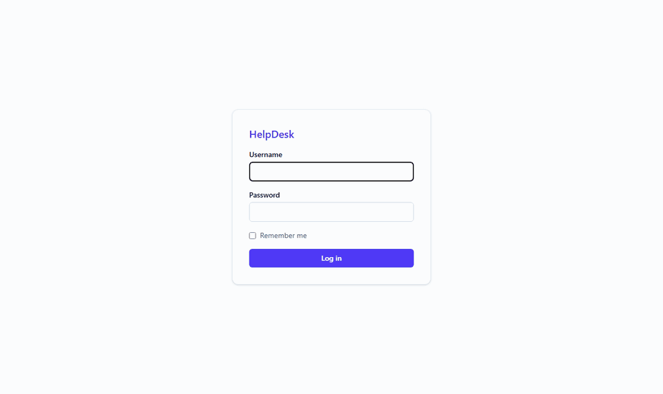
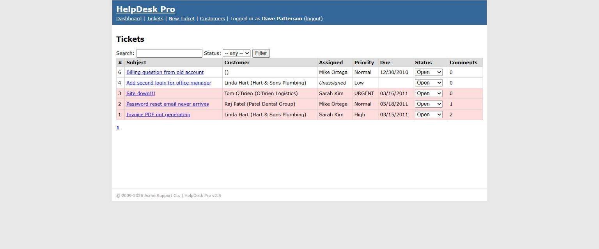
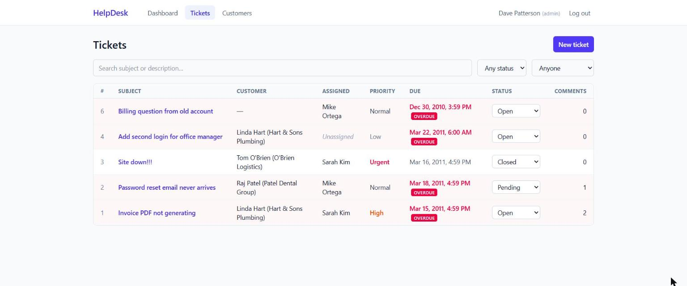
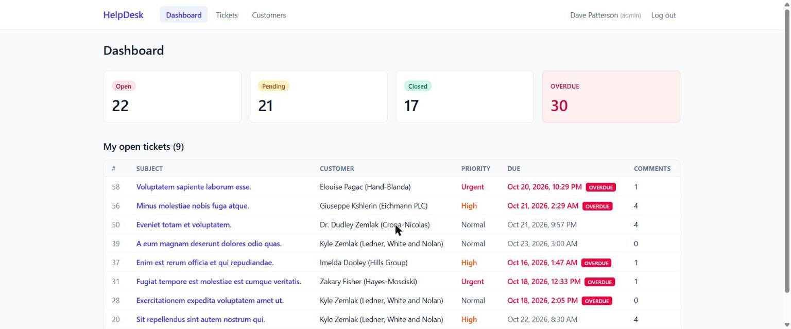
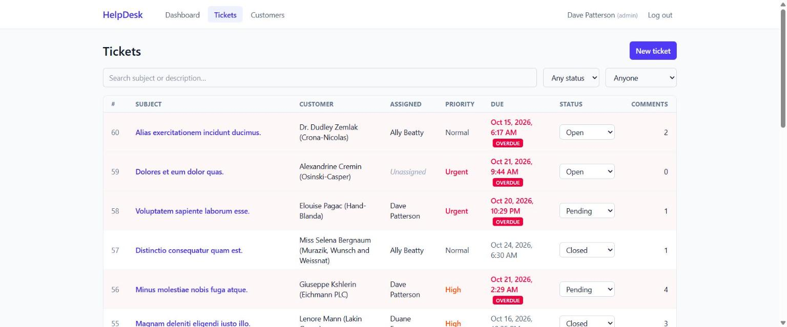
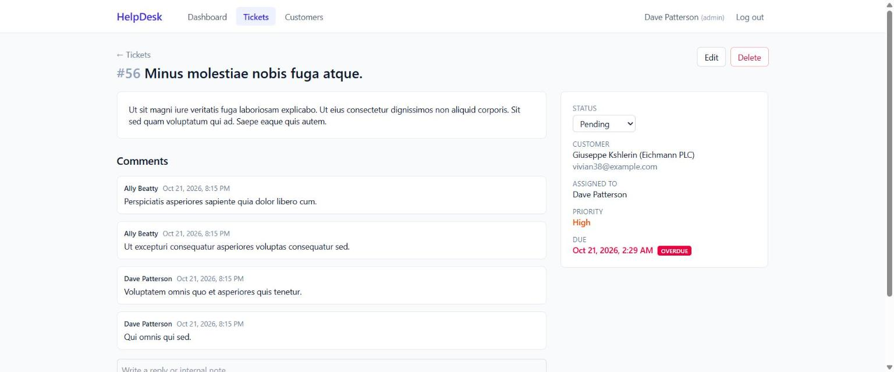

# Legacy LAMP → Laravel + Vue: a modernization case study

[](https://github.com/GodfreysDragon/lamp-modernization-case-study/actions/workflows/ci.yml) [](LICENSE)

A complete, runnable before-and-after of modernizing a legacy PHP/MySQL application. It's written for the agencies and in-house teams who have exactly this app sitting in their codebase.



| | **Before:** [`legacy/`](legacy) | **After:** [`modern/`](modern) |
|---|---|---|
| Stack | Procedural PHP 7.4, mysqli, jQuery 1.8, MyISAM | Laravel 13, Vue 3 + Inertia, Vite, Tailwind 4 |
| Data access | 22 hand-built SQL strings, 11 with request data concatenated in | Eloquent; one static `selectRaw`, no user input |
| Output escaping | 0 calls to `htmlspecialchars()` | Escaped by default (Vue `{{ }}`) |
| Auth | MD5, SQL-injectable login, no rate limit, one endpoint with no login check | bcrypt (transparent upgrade from MD5), throttled, policies on every write |
| Queries for a 20-row ticket list | 62 | 5 (constant, asserted by tests) |
| Business rules | SLA defined twice (inconsistently); overdue check broken every December | One enum, one model method, unit-tested |
| Tests | None | **112** (98 Pest + 1 real-browser + 13 Vitest), ~20s |
| Code coverage | — | **95.1%** (measured in CI, must stay above 90%) |
| Static analysis (PHPStan level 8) | 43 errors | **0** |
| Data migration | — | Idempotent, dry-runnable `php artisan legacy:import` that cleans up 15 years of drift |

**The app:** *HelpDesk Pro*, a support-ticket system of the kind a small company built in 2009 and still runs. It has agents, customers, tickets with priorities and SLAs, comments and internal notes, and a dashboard. The legacy code is written from scratch to faithfully reproduce the patterns found in real codebases of that era, including the security holes, the copy-pasted business rules and the messy data.

## Before and after, same data

The legacy ticket list, and the same tickets after `php artisan legacy:import` into the modern app:

| Before: legacy PHP + jQuery | After: Laravel + Vue |
|---|---|
|  |  |

Some things to compare:
- **Ticket #6:** the legacy app shows it as due 12/30/2010 but not overdue. That's the December bug, where dates are compared as `m/d/Y` strings. The modern app flags it.
- **Customers and priorities:** the orphaned customer shows as `()` in the legacy list and as an explicit "—" after import. Priority casing (`URGENT`) is normalized.
- **Status dropdowns:** every legacy dropdown shows "Open" because of inconsistent status casing. The modern list shows each ticket's real status.

## The modern app



| Ticket list: search, filters, inline status change | Ticket detail: comments and internal notes |
|---|---|
|  |  |

## Read the case study

1. **[Legacy audit](docs/01-legacy-audit.md)**: 22 findings with file and line references, rated by severity
2. **[Migration strategy](docs/02-migration-strategy.md)**: characterize → rebuild → import → cut over, with a rollback plan
3. **[Before/after code](docs/03-before-after.md)**: raw SQL → Eloquent, jQuery → Vue, N+1 → eager loading, MD5 → bcrypt
4. **[Testing strategy](docs/04-testing-strategy.md)**: characterization tests, plus a regression test for every audit finding
5. **[Business case](docs/05-business-case.md)**: cost of inaction vs cost of modernizing, payback in ~4 months

## Run it

**Modern app** (PHP 8.3+, Composer, Node 20+):
```bash
cd modern
composer install && cp .env.example .env && php artisan key:generate
touch database/database.sqlite && php artisan migrate --seed
npm install && npm run build
php artisan serve        # http://localhost:8000 (admin / admin123)
npx playwright install chromium   # once, for the browser test
php artisan test && npm test
```

**Legacy app** (Docker):
```bash
cd legacy
docker compose up        # http://localhost:8080/login.php (admin / admin123)
```

**Import legacy → modern:** with the legacy containers running, set `LEGACY_DB_PORT=3307` and `LEGACY_DB_PASSWORD=hunter2` in `modern/.env`, then run `php artisan legacy:import --dry-run`. Against the bundled seed data, it imports 3 users, 3 customers, 6 tickets (one soft-deleted) and 3 comments. It warns about ticket #6, whose customer no longer exists, and comment #4, whose ticket no longer exists. Re-running it changes nothing. Imported users log in with their old passwords, and the MD5 hash is replaced with bcrypt on first login.

> ⚠️ The legacy app is **deliberately insecure**. Run it locally only and never expose it to a network.

## Limitations

- The static-analysis figure measures types and logic, not security. The security findings are covered by the [audit](docs/01-legacy-audit.md) and its regression tests.
- The [business case](docs/05-business-case.md) figures are a worked example with stated assumptions, not client data.

## Repository layout

```
legacy/                    the "before": runnable with Docker
  login.php, index.php, tickets.php, ticket.php, ticket_edit.php, customers.php
  ajax/                    jQuery endpoints
  includes/                db.php, functions.php, header/footer
  js/app.js                jQuery
  schema.sql, seed.sql     MyISAM schema + realistically messy data
modern/                    the "after": Laravel 13 + Vue 3 (Inertia)
  app/Enums, Models, Http/{Controllers,Requests,Resources}, Policies
  app/Console/Commands/ImportLegacyData.php
  resources/js/{pages,components,layouts}
  tests/{Characterization,Unit,Feature,Browser}  +  resources/js/**/*.test.js
docs/                      the case study
```

## License

[MIT](LICENSE)
